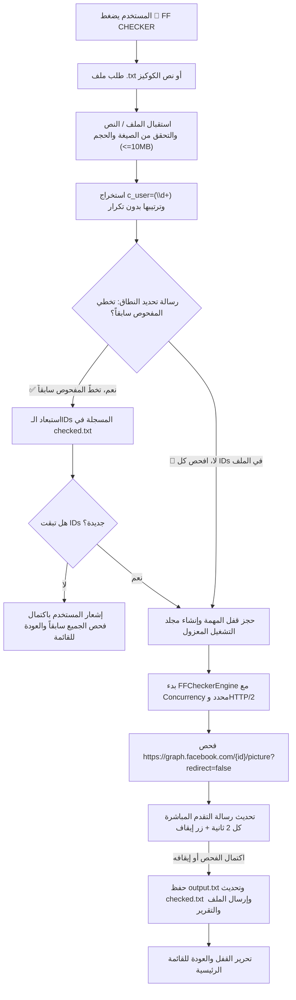

# FF Checker Tool Implementation Report

## 1. ملخص تنفيذي (Executive Summary)

تم بنجاح دمج وتطوير أداة **FF Checker** كأداة مستقلة تماماً داخل بوت تيليجرام لمشروع `ko-main`، مستخلصة من السكربت الأصلي `ff.py`، مع تحقيق المعايير الهندسية الصارمة:
1. **الاستقلالية التامة وعدم اشتراط التوكن:** الأداة لا تتطلب إدخال Facebook Access Token ولا تعتمد على جلسة مسجلة في البوت، ويمكن تشغيلها مباشرة.
2. **عدم المساس بالوظائف الأساسية:** الحفاظ الكامل على تدفقات `CONNECT GROUPS` و`APPROVE MEMBERS` و`MODERATOR APPROVAL`.
3. **حماية الخصوصية والأمان:** استخراج وتجريد معرفات `c_user` فقط، مع استبعاد تام وتام لكوكيز الجلسة الحساسة (`xs`, `datr`, `fr`, إلخ) من الرسائل وسجلات التتبع والملفات المحفوظة.
4. **عزل المهام وإدارة الملفات:** حفظ مدخلات ومخرجات كل مستخدم في مجلد تشغيل معزول `data/ff_checker/runs/{chat_id}/`، مع حماية الملف المشترك `checked.txt` عبر قفل Mutex متعدد الخيوط لمنع التعارضات (Race Conditions).
5. **خيارات النطاق (Scope Selection):** إتاحة خياري التخطي الذكي للمفحوص سابقاً أو إعادة الفحص الكامل.
6. **تصنيف دقيق وموثوق:** تصنيف الردود إلى `CONFIRMED`، `INVALID` (Code 803)، `UNKNOWN`، `NETWORK_ERROR`، و`RATE_LIMITED`.
7. **واجهة تقدم تفاعلية وإيقاف فوري:** تحديث التقدم المباشر كل ثانيتين مع زر إيقاف فوري `🛑 إيقاف الفحص` وتوافق تام مع `🚫 TERMINATE`.
8. **اجتياز الاختبارات بنسبة 100%:** تنفيذ 26 اختباراً شاملاً للأداة الجديدة واجتياز كافة اختبارات المشروع البالغ عددها 103 اختبارات بنجاح تام.

---

## 2. هيكلية التعديلات والملفات المضافة

| الملف / المسار | نوع التعديل | الدور والوظيفة |
| :--- | :--- | :--- |
| `tools/__init__.py` | جديد | تهيئة الحزمة `tools` كحزمة بايثون معيارية. |
| `tools/ff_checker.py` | جديد | المحرك الأساسي للأداة: استخراج الـ IDs، دوال القراءة والكتابة الآمنة، فحص Graph API العام، وإدارة دورة حياة المهام التفاعلية. |
| `bot/keyboards.py` | تعديل | إضافة زر `🔎 FF CHECKER` في القائمة الرئيسية ولوحة أزرار تحديد النطاق `get_ff_scope_buttons()`. |
| `bot/state.py` | تعديل | إضافة حالات المحادثة `S_INPUT_FF_FILE` (استقبال الملف) و`S_FF_WAIT_SCOPE` (اختيار النطاق). |
| `utils/validation.py` | تعديل | إضافة الرمز `🔎` لقائمة المستبعدات التلقائية في `parse_id_list` لمنع حقن نصوص الأزرار كمعرفات مجموعات. |
| `bot/handlers.py` | تعديل | ربط معالجات الرسائل والأزرار والملفات وعزل المهام وتنسيق التقارير لتدفق الـ FF Checker. |
| `tests/test_ff_checker.py` | جديد | 26 اختباراً آلياً تغطي الاستخراج، التصنيف، إدارة الملفات، التزامن، والواجهة التفاعلية. |

---

## 3. التدفق الإجرائي للأداة (Workflow Details)



---

## 4. آليات العمل الفنية والضمانات

### 4.1 استخراج المعرفات وحماية الخصوصية (Zero-Leakage Privacy)
- يتم فحص الأسطر باستخدام التعبير النمطي `c_user=(\d+)`، مع دعم احتياطي للأسطر التي تحتوي أرقام معرفات مباشرة.
- يتم استبعاد التكرارات مع الحفاظ الدقيق على ترتيب أول ظهور لكل معرف (`seen: set`, `extracted: list`).
- يُكتب في `input.txt` فقط قائمة المعرفات الصافية، وتُحذف الكوكيز الحساسة كلياً من الذاكرة دون تخزينها في السجلات أو الرسائل.

### 4.2 استعلام Facebook Graph API والتصنيف الدقيق
- يتم الاستعلام عبر الرابط العام:
  `GET https://graph.facebook.com/{user_id}/picture?redirect=false`
  دون إرسال أي `access_token` في الـ query params أو الـ headers.
- **التصنيفات المعتمدة:**
  - `CONFIRMED`: عند استلام HTTP 200 واحتواء حقل البيانات `data` على `height` و`url`.
  - `INVALID`: عند استلام HTTP 400 أو 404 واحتواء الخطأ على الرمز `803` أو نص "Aliases you requested do not exist".
  - `RATE_LIMITED`: عند استلام HTTP 429 من خوادم فيسبوك.
  - `NETWORK_ERROR`: عند حدوث مهلة اتصال `TimeoutException` أو تعذر الاتصال بالشبكة `ConnectError`.
  - `UNKNOWN`: أي استجابة غير معيارية أو غير حاسمة، ولا تُعتبر دليلاً على صحة الحساب.

### 4.3 إدارة التزامن والقفل المشترك (Thread-Safe Isolation)
- حماية ملف `checked.txt` عبر `threading.Lock` لضمان عدم تلف البيانات أثناء الفحص أو القراءة المتزامنة.
- منع ازدواجية تشغيل المهام للمحادثة الواحدة باستخدام `state.acquire_task_lock(chat_id)` و`state.release_task_lock(chat_id)`.
- حظر استهلاك موارد السيرفر بواسطة `asyncio.Semaphore(concurrency)` المحدد افتراضياً بـ 5 اتصالات متوازية.

---

## 5. نتائج الاختبارات الآلية (Test Suite Results)

تم تشغيل حزمة الاختبارات بالكامل عبر `pytest`:

```text
============================= test session starts =============================
platform win32 -- Python 3.12.10, pytest-9.1.1, pluggy-1.6.0
rootdir: C:\Users\Admin\Downloads\ko-main
plugins: anyio-4.12.1, Faker-40.1.0
collected 103 items

tests\test_config.py ...                                                 [  2%]
tests\test_facebook_client.py ........                                   [ 10%]
tests\test_ff_checker.py ..........................                      [ 35%]
tests\test_legacy_behavior.py .........                                  [ 44%]
tests\test_progress.py ...                                               [ 47%]
tests\test_request_snapshots.py .....                                    [ 52%]
tests\test_resilience_and_edge_cases.py .........                        [ 61%]
tests\test_smoke.py .                                                    [ 62%]
tests\test_state.py ....                                                 [ 66%]
tests\test_telegram_handlers.py ............                             [ 77%]
tests\test_validation.py ....                                            [ 81%]
tests\test_worker_engine.py ....                                         [ 85%]
tests\test_workflow_and_speed.py ...............                         [100%]

============================ 103 passed in 21.78s =============================
```

- **عدد الاختبارات الكلي:** 103 اختباراً (77 اختباراً سابقاً + 26 اختباراً جديداً لـ FF Checker).
- **نسبة النجاح:** 100% نجاح بدون أي تحذيرات أو أخطاء.
- **التوافق البرمجي:** اجتياز الفحص البرمجي التجميعي `python -m compileall .` بنجاح 100%.

---

## 6. القيود الهندسية والحدود التقنية الحالية (Known Limitations & Constraints)

1. **طبيعة التحقق من الصورة العامة (Public Picture vs. Active Session):**
   - استعلام نقطة النهاية `graph.facebook.com/{user_id}/picture` هو استعلام عام (Public Graph Endpoint) لا يتطلب تسجيل دخول.
   - نجاح العملية وتصنيفها كـ `CONFIRMED` يثبت أن الحساب موجود ولديه ملف تعريف / صورة في قاعدة بيانات فيسبوك، لكنه **لا يثبت** أن الكوكيز أو الجلسة المصاحبة صالحة لتسجيل الدخول أو لم تنتهِ صلاحيتها (Session Validity/Cookie Expiry)، حيث يتطلب التحقق من صلاحية الجلسة نفسها محاكاة مصادقة ويب كاملة بحسابات المستخدمين وهو ما يخرج عن نطاق فحص المعرفات السريع وبدون توكن.
2. **حدود معدل الطلبات (Meta Graph Rate Limits):**
   - نظراً لأن الطلبات تُرسل بدون توكن (Unauthenticated IPs)، قد تفرض فيسبوك قيود مؤقتة (HTTP 429) عند فحص آلاف الـ IDs بمعدلات فائقة السرعة من نفس عنوان الـ IP؛ لذا تم تحديد الـ Concurrency افتراضياً بسقف معقول (5) لتفادي الحظر المؤقت لعنوان الـ IP.
